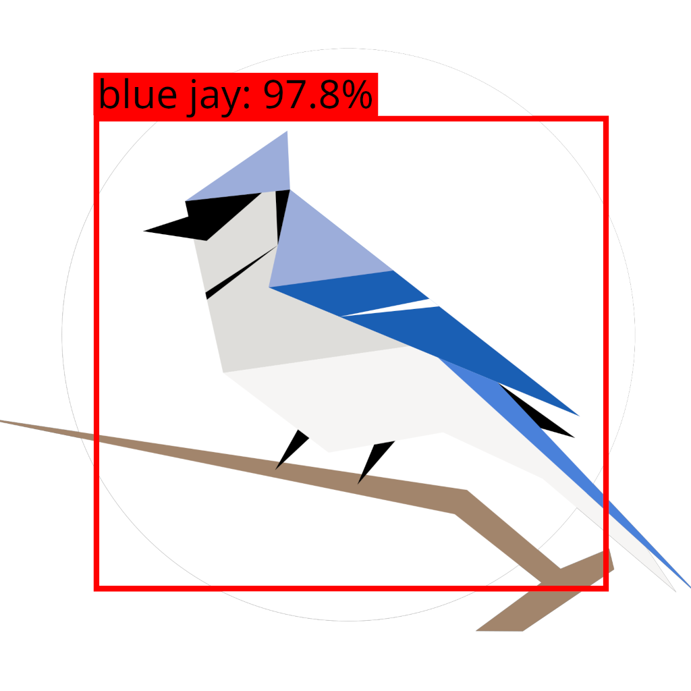
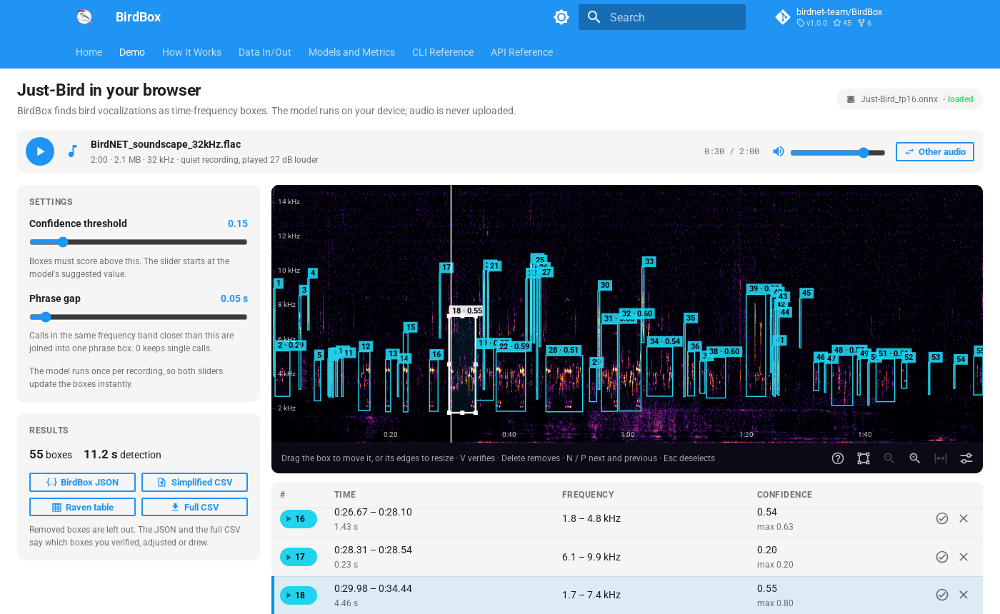

<div align="center">
  <h1>BirdBox</h1>
  
  
  
  <p><strong>Deep Learning Bird Call Detection & Evaluation System</strong></p>
  
  <a href="#license"></a>
  <a href="https://www.python.org/downloads/release/python-31213/" target="_blank" rel="noopener noreferrer"></a>

</div>

BirdBox is a comprehensive system for detecting and evaluating bird calls in audio recordings using deep learning. It leverages YOLO (You Only Look Once) object detection on spectrogram images to identify and localize bird vocalizations in time and frequency.

⚠️ **Note**: This project is still under active development. Performance may vary.

## Documentation

Everything you need, including installation instructions, an interactive demo, model metrics, and the CLI Reference, can be found in the [BirdBox Documentation](https://birdnet-team.github.io/BirdBox/).

## Quick Links

- [Installation](https://birdnet-team.github.io/BirdBox/installation/) - set up the environment
- [Data Flow](https://birdnet-team.github.io/BirdBox/data/fileflows/) - pipeline description
- [Models and Metrics](https://birdnet-team.github.io/BirdBox/models-and-metrics/overview/) - list of models with corresponding metrics
- [CLI Reference](https://birdnet-team.github.io/BirdBox/cli/workflows/) - command line interface
- [API Reference](https://birdnet-team.github.io/BirdBox/api/api-type/) - application programming interface

## Demo

Try the [Demo](https://birdnet-team.github.io/BirdBox/demo/) in your browser: it runs the Just-Bird model (or All-In-One, from the model menu) on your device, with no installation and no upload. Load a recording, tune the confidence and phrase gap, review and edit the boxes, and export them in the BirdBox output formats.

<picture>
  <source media="(prefers-color-scheme: dark)" srcset="docs/img/demo_screenshot_dark.png">
  
</picture>

## Citation

Feel free to use BirdBox for your acoustic analyses and research. If you do, please cite as:

```bibtex
@software{Schlosser_BirdBox,
    author = {Schlosser, Elias and Kahl, Stefan and Eibl, Maximilian},
    license = {MIT (code), AGPL-3.0 (project as a whole)},
    title = {{BirdBox}},
    url = {https://github.com/birdnet-team/BirdBox}
}
```

## License

BirdBox's own source code is licensed under the [MIT License](LICENSE).

BirdBox is built on [Ultralytics YOLO11](https://github.com/ultralytics/ultralytics), which is licensed under the [AGPL-3.0](LICENSE-AGPL-3.0). Ultralytics also treats models trained or fine-tuned with it as AGPL-3.0, so the BirdBox model weights (`.pt` and every exported format) are AGPL-3.0 as well. As a result, the project as a whole is subject to the AGPL-3.0:

- **Using BirdBox with Ultralytics or the BirdBox models** (running, redistributing, or offering it over a network) has to comply with the AGPL-3.0. If you modify it and let users interact with it over a network, you must offer them its source code.
- **Reusing BirdBox's own code** on its own, in a project that uses neither Ultralytics nor the BirdBox models, is possible under the MIT terms.

A few files are under other licenses (a function adapted from librosa, xeno-canto audio samples, AviList-derived taxonomy data). See [NOTICE.md](NOTICE.md) for the full breakdown.

## Funding

Our work in the K. Lisa Yang Center for Conservation Bioacoustics is made possible by the generosity of K. Lisa Yang to advance innovative conservation technologies to inspire and inform the conservation of wildlife and habitats.

The development of BirdNET is supported by the German Federal Ministry of Research, Technology and Space (FKZ 01|S22072), the German Federal Ministry for the Environment, Climate Action, Nature Conservation and Nuclear Safety (FKZ 67KI31040E), the German Federal Ministry of Economic Affairs and Energy (FKZ 16KN095550), the Deutsche Bundesstiftung Umwelt (project 39263/01) and the European Social Fund.

## Partners

BirdNET is a joint effort of partners from academia and industry.
Without these partnerships, this project would not have been possible.
Thank you!


