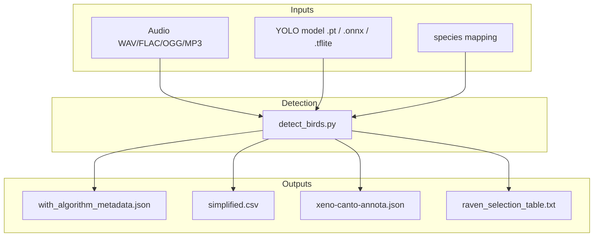
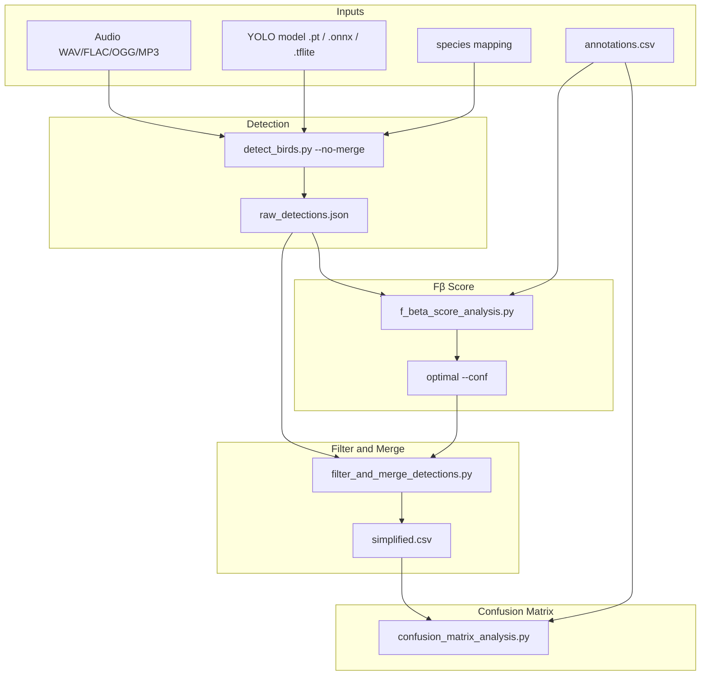

# File Flows

BirdBox moves data through a small set of file types. Audio and models go in, detections and evaluation results come out. This section describes these files for pipeline scripts, external tools, and anyone wiring BirdBox into a larger workflow.

---

## File Flow for Detection Only

For field use or exporting annotations. No ground-truth CSV and no evaluation scripts. You run inference once at a chosen `--conf`. `detect_birds.py` merges the boxes of the overlapping windows itself (see [Merging the Windows](../how-it-works/overview.md#merging-the-windows)).

Use `--output-format all` to write every format in one run, or pick a single format. Details are on [Detection Output Formats](outputs.md) in this section.

---

## File Flow for Detection and Evaluation

For benchmarking on a labeled test set. Run detection once at a very low confidence with `--no-merge`. Find the best threshold against `annotations.csv`. Then filter and merge at that threshold and score the errors. This matches `run_pipeline.sh` at the repository root.

Just-Bird has one `bird` class, while the labels name species. Pass `--single-cls` to both evaluation scripts so that every label counts as `bird`. In `run_pipeline.sh`, `USE_SINGLE_CLS=true` sets it.

Step-by-step CLI usage for each script is under [CLI Reference](../cli/workflows.md) in the site navigation.
