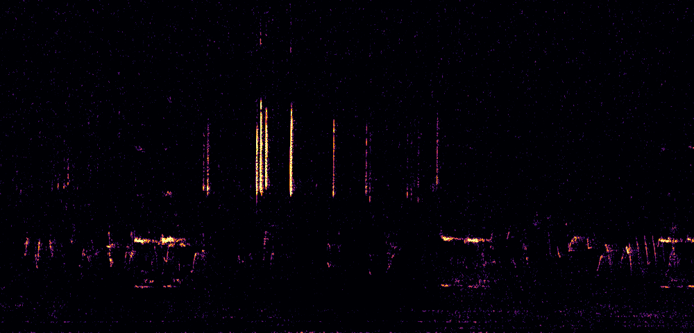
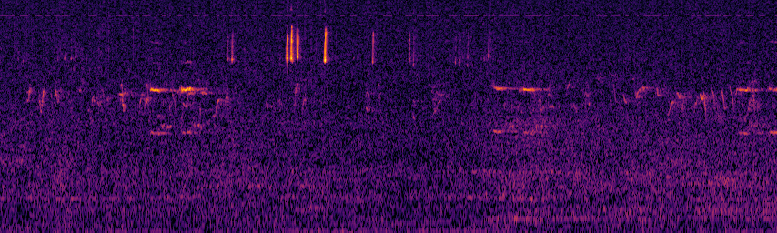
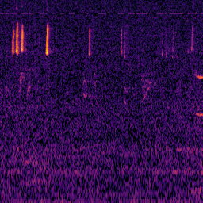

# Spectrogram in the Demo

The viewer shows an STFT spectrogram by default. In its display settings, *Log-floor* switches to the log-floor mel spectrogram BirdBox detects on. The two are drawn for different readers. The STFT view is tuned so that calls stand out for people. The log-floor view is what the network is given, made as described in [Spectrogram Generation](spectrogram.md). The figure shows both for ten seconds of the sample soundscape (40–50 s), with the boxes Just-Bird finds at the demo's defaults. Point at either view: the cross marks the same time and frequency in both.

  

    <label for="sv-boxes"><input type="checkbox" id="sv-boxes" checked> Boxes</label>
    <label for="sv-window"><input type="checkbox" id="sv-window" checked> The window shown below</label>
  

  

    
<strong>STFT view</strong>the default · linear, 0–15 kHz · Hann window of 1024 samples

    

    
<canvas></canvas>

  

  

    
<strong>Log-floor view</strong>what the model is given · mel, 50 Hz–15 kHz · flat-top window of 2048 samples

    

    
<canvas></canvas>

    

  

- **Background.** The STFT view starts its colours 7 dB above each band's median, so ordinary noise is black. The model's picture starts 3 dB below the band's 20th percentile. It sees the noise as a purple texture and has to tell the calls from it. A box can therefore sit where the STFT view looks empty: on a faint sound that the STFT view draws black. *Log-floor* shows what the model saw there.
- **Frequency axis.** Mel bands give low frequencies far more room. Half of the log-floor view lies below 2.7 kHz, while in the STFT view that range takes the bottom fifth.
- **Loudest colour.** The STFT view turns white at the file's loudest 0.05 %, but never below 24 dB above the median (here at 24 dB). The model's picture always turns white at 45 dB above its floor.
- **Sharpness.** The STFT's shorter window draws calls sharper in time and narrower in frequency. The model's [flat-top window](spectrogram.md#why-flat-top) smears them, so its boxes can look loose on the STFT view.

## One Window

The network gets each 3 s window as a 256 × 256 image: the window's 252 frames stretched to 256 columns, the 256 mel bands as rows, and −3 to +45 dB above the window's [noise floor](spectrogram.md#stage-5-log-floor-normalization) in the 256 colours of inferno. This is the window from 43.5 to 46.5 s, marked in the figure above:

  

    

    
<canvas></canvas>

    

  

A window's pixels depend on its own noise floor, so the viewer shows each stretch of 1.5 s with the floor of the window that ends there, which are the pixels the model sees in the second half of that window. For this window, the log-floor view and the model's image hold the same values. While recording, the floor is a running estimate over the last 60 s.

## Levels

Each picture cuts the audio into short frames and measures how loud the band at 4.0 kHz is in each. The grey areas show how often each loudness occurs, in dB above the band's median. 0&nbsp;dB is the band's median in this recording, not a fixed sound level; turning the recording up or down moves nothing in the chart. The tall hump is the background noise, which most frames hold. The thin tail to the right is the calls: rare, but up to 25–30 dB louder.

- **Model:** the mel band, over the frames its noise floor is taken from. These are the 46.5 s up to the window's end, because the file starts at 0&nbsp;s (see [The Start of a File](#the-start-of-a-file)). The dashed line is their 20th percentile, the floor.
- **STFT view:** one frequency bin of the STFT, over the whole file. Its hump is a little wider: a single bin of 31 Hz flickers more than a mel band, which adds up several bins over a longer window.

The bar under each row shows the range that picture spreads its colours over: levels left of the colours are black, levels right of them white. The model starts 3 dB below its floor, 6.6 dB below the median, so nearly all of the noise shows. The STFT view starts 7 dB above the median, so nearly all of the noise is black.

<svg class="sv-chart" id="sv-levels" role="img" aria-label="The levels of one band as each view measures them, and the range each view draws in colour"></svg>

## The Start of a File

A window's noise floor comes from the 60 s up to its end. At the start of a file there is less: the first window's floor comes from its own 3 s, and only windows that end at 60 s or later get a full minute. With few frames the floor is less certain, and calls in a band lift its 20th percentile. On 64 starts cut from nine longer recordings, the floor 3 s into the file differed from the full minute's by 0.9 dB in the median band and by more than 3 dB in 18% of the bands. On average it was 0.4 dB higher, so the picture comes out slightly darker. With Just-Bird at the defaults, 13–16% of the boxes in the first 12 s changed (no box at IoU 0.5 in the other run), 9% from 12 to 30 s, 3.5% from 30 to 57 s, and none after 63 s. Against labels, the first 5 s of the Hawai'i validation recordings score 0.006–0.009 lower in F1 at IoU 0.5 than with a floor over each whole minute ([BirdBox-Train repository](https://github.com/birdnet-team/BirdBox-Train){ target="_blank" rel="noopener noreferrer" }, `holdout_ssn/RESULTS.md`). Just-Bird was trained with a floor over each whole minute, so it never saw such short floors.

A microphone that starts quiet pulls the floor down for up to 60 s, and the picture comes out brighter. With 0.5 s of near-silence at the start, 9% of the boxes from 6 to 12 s changed and 2% after 30 s. A fade-in of 0.3 s changes boxes mainly in the first seconds. Digital silence is left out of the floor.

The two views show this differently:

- **STFT view:** its floor comes from the whole file, so the start looks like the rest of the file and shows none of this.
- **Log-floor view:** it shows the model's pixels, the start included.
- **While recording:** the log-floor view levels its first frames with a floor from the first 0.14 s, and later frames with one from a sample of the frames so far. It does not redraw them, so its first seconds can look brighter than what the model sees. After *Stop*, it shows the model's pixels.

## Frequency Axes

The shaded range, 50 Hz to 2.7 kHz, fills half of the model's rows. Most of the bird song in the sample lies between 2 and 10 kHz.

<svg class="sv-chart" id="sv-frequencies" role="img" aria-label="The linear and the mel frequency axis, with lines between equal frequencies"></svg>

## The Two Views Compared

| | STFT view | Log-floor view and the model |
| :--- | :--- | :--- |
| Window and hop | Hann, 1024 samples (32 ms), every 10 ms | Flat-top, 2048 samples (64 ms), every 11.7 ms |
| Frequencies | Linear, 0–15 kHz, 31 Hz per row | 256 mel bands, 50 Hz–15 kHz |
| Noise floor | Each band's median over the whole file | Each band's 20th percentile over the 60 s before each window's end, less at the start of a file |
| Black at | 7 dB above the median | 3 dB below the floor |
| White at | The file's loudest 0.05 %, at least 24 dB above the median | 45 dB above the floor |
| Recorder gain | Cancels out | Cancels out |
| While recording | A running estimate of each band's median over the last 20 s | A running estimate of the floor over the last 60 s |

Brightness, contrast and the colour map in the display settings change how either view looks, never what the model gets. `scripts/make_spectrogram_views.mjs` makes the figures from the demo's own spectrogram code (`docs/javascripts/demo/spec-worker.js`, the viewer's colours at their defaults) and the Just-Bird graph at the demo's defaults. It also checks that the log-floor view holds the model's values for the window.
