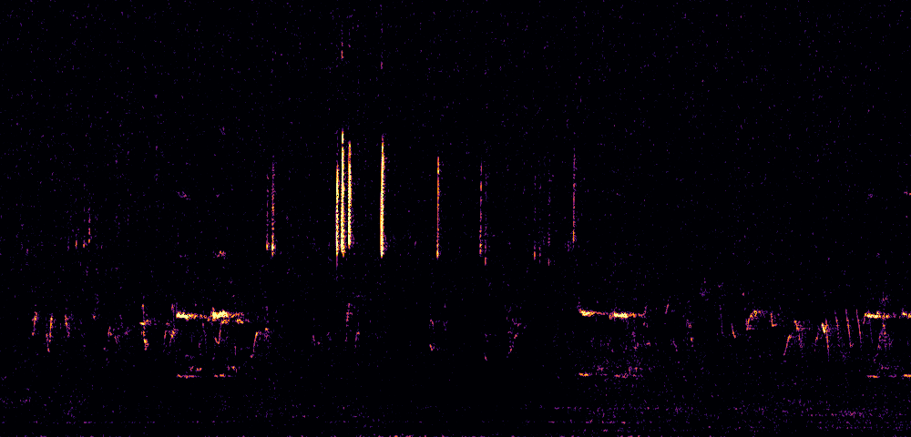
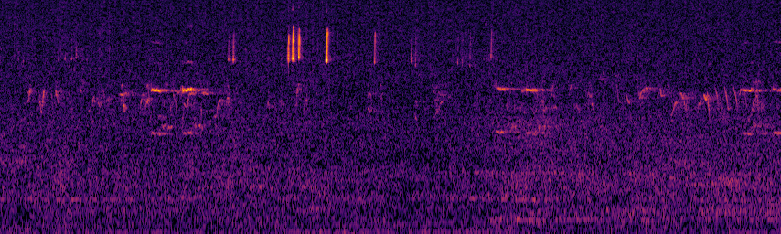
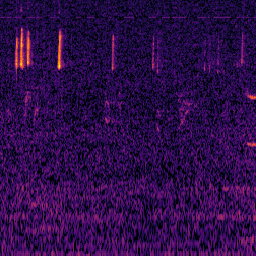

# The Browser Demo

The [Demo](../demo.md) runs a self-contained BirdBox graph with [ONNX Runtime Web](https://onnxruntime.ai/docs/tutorials/web/){ target="_blank" rel="noopener noreferrer" } in your browser. The graph computes the log-floor spectrogram, runs the YOLO detector on 3 s windows every 1.5 s and applies NMS, just like [`detect_birds.py`](../cli/detect-birds.md) with the same model. The model menu at the top picks the graph:

- **Just-Bird** (`docs/models/Just-Bird_fp16.onnx`, the default): every box is a bird vocalization (`bird`), without species labels. For species, combine the boxes with [BirdNET](https://github.com/birdnet-team/BirdNET-Analyzer){ target="_blank" rel="noopener noreferrer" }.
- **Birds-With-Labels** (`docs/models/Birds-With-Labels_fp16.onnx`): the [Birds-With-Labels](../models-and-metrics/birds-with-labels.md) model with its 633 classes. The table names the species of each box.

This page explains how the demo detects, what its spectrogram shows and how to add a model.

## Detection

**Boxes while it runs.** New boxes appear after every 1.5 s of audio, and the part not analyzed yet is dimmed. Each window's noise floor comes from the 60 s before the window's end ([rolling floor](spectrogram.md#stage-5-log-floor-normalization)), so nothing depends on where a minute starts: the spectrogram is computed one window at a time and kept, and each window goes through the network as soon as its frames are there. The floor itself is computed in the page: each band's frames of the last 60 s are kept sorted, and from one window to the next only the 128 frames that leave and the 128 that arrive are merged in, so the network gets only the window's own frames (`tests/js/demo_floor.mjs`). The rows are the same as in one run of the whole graph (`tests/js/demo_chunk_parity.mjs`).

**Pace.** The windows show evenly spaced: a few finished windows, about 0.6 s of work, are held back and shown at the mean pace, which covers windows that take longer (`docs/javascripts/demo/pacer.js`, `tests/js/demo_pacer.mjs`). The progress line and, at the end, the summary show how many seconds of audio a second of detection covers ("9.5× real time").

**Dashed boxes.** Rows are final once they are there, but the next windows can still change the boxes near the end of the analyzed part: fuse them with theirs, hide them as nested, or join them into a phrase. Such boxes are dashed: those that end less than 1.5 s plus the gap before it, and the boxes linked to them, of the same class, at most the gap apart and, for window fusion, with overlapping bands. That covers a growing phrase, whose band widens as it takes in new calls, so that it can take in a box beside it that ended long before. Solid boxes do not change any more (`docs/javascripts/demo/pending.js`, `tests/js/demo_dashed_boxes.mjs`). With window fusion, the boxes no later window can reach are fused once and kept, so an update only fuses the newest rows, with the same boxes as fusing all rows anew (`docs/javascripts/demo/fusion.js`, `tests/js/demo_fusion_parts.mjs`).

**Stop and continue.** Exports unlock when the whole recording is done. If you stop detection, *Continue Detecting* picks it up where it stopped, and the result is the same as an uninterrupted run. While it is stopped, you can export the boxes found so far, and a note under the export buttons says that the export does not cover the whole file. The file names of such exports end in `_partial`, and the JSON also states how far detection got (`demo.partial`, `demo.analyzed_until_s`, `demo.audio_duration_s`).

## Instant Sliders

The model runs once per recording, at the lowest confidence of the slider (0.05). The demo asks the graph for its per-window boxes (`raw_all`) and repeats the graph's merge in JavaScript. For Just-Bird that is window fusion: window ownership and weighted box fusion, removing nested boxes, joining calls into phrases. For Birds-With-Labels it is song reconstruction: boxes of one species closer than the song gap become one box. NMS only lets higher-scoring boxes suppress lower ones, so the boxes for any confidence and gap are the same as a graph run with those values.

## Recording

When you record, the spectrogram flies in from the right, and boxes appear a few seconds after a sound. A window's noise floor comes from the audio before its end, so each window is detected once, as soon as it is complete, and its rows are final. Only new audio becomes spectrogram frames, so a window takes a fraction of a second. Only the boxes the next windows may still change are dashed, as in a file. When you stop, only the last few windows are left, and the result is the same as loading the saved file (`tests/js/rolling_floor_live.mjs`). Recordings are saved as 32 kHz, 16-bit WAV, what BirdBox reads, without the compression of a typical browser recording. Nothing leaves your device.

## Spectrogram

The viewer shows an STFT spectrogram by default. In its display settings, *Log-floor* switches to the log-floor mel spectrogram BirdBox detects on. The two are drawn for different readers. The STFT view is tuned so that calls stand out for people. The log-floor view is what the network is given, made as described in [Spectrogram Generation](spectrogram.md). The figure shows both for ten seconds of the sample soundscape (40–50 s), with the boxes Just-Bird finds at the demo's defaults. Point at either view: the cross marks the same time and frequency in both.

<div class="sv-figure" id="sv-views" data-src="../../img/how-it-works/spectrogram_views.json">
  <div class="sv-controls">
    <label for="sv-boxes"><input type="checkbox" id="sv-boxes" checked> Boxes</label>
    <label for="sv-window"><input type="checkbox" id="sv-window" checked> The window shown below</label>
  </div>
  <div class="sv-view">
    <div class="sv-head"><strong>STFT view</strong><span>the default · linear, 0–15 kHz · Hann window of 1024 samples</span></div>
    <div class="sv-axis" data-axis="linear"></div>
    <div class="sv-stage" data-view="stft"><canvas></canvas></div>
  </div>
  <div class="sv-view">
    <div class="sv-head"><strong>Log-floor view</strong><span>what the model is given · mel, 50 Hz–15 kHz · flat-top window of 2048 samples</span></div>
    <div class="sv-axis" data-axis="mel"></div>
    <div class="sv-stage" data-view="logfloor"><canvas></canvas></div>
    <div class="sv-time" data-axis="views"></div>
  </div>
</div>

- **Background.** The STFT view starts its colours 7 dB above each band's median, so ordinary noise is black. The model's picture starts 3 dB below the band's 20th percentile. It sees the noise as a purple texture and has to tell the calls from it. A box can therefore sit where the STFT view looks empty: on a faint sound that the STFT view draws black. *Log-floor* shows what the model saw there.
- **Frequency axis.** Mel bands give low frequencies far more room. Half of the log-floor view lies below 2.7 kHz, while in the STFT view that range takes the bottom fifth.
- **Loudest colour.** The STFT view turns white at the file's loudest 0.05 %, but never below 24 dB above the median (here at <span data-sv="hi">24</span> dB). The model's picture always turns white at 45 dB above its floor.
- **Sharpness.** The STFT's shorter window draws calls sharper in time and narrower in frequency. The model's [flat-top window](spectrogram.md#why-flat-top) smears them, so its boxes can look loose on the STFT view.

### One Window

The network gets each 3 s window as a 256 × 256 image: the window's 252 frames stretched to 256 columns, the 256 mel bands as rows, and −3 to +45 dB above the window's [noise floor](spectrogram.md#stage-5-log-floor-normalization) in the 256 colours of inferno. This is the window from 43.5 to 46.5 s, marked in the figure above:

<div class="sv-figure sv-window">
  <div class="sv-view">
    <div class="sv-axis" data-axis="mel"></div>
    <div class="sv-stage" data-view="window"><canvas></canvas></div>
    <div class="sv-time" data-axis="window"></div>
  </div>
</div>

A window's pixels depend on its own noise floor, so the viewer shows each stretch of 1.5 s with the floor of the window that ends there, which are the pixels the model sees in the second half of that window. For this window, the log-floor view and the model's image hold the same values. While recording, the floor is a running estimate over the last 60 s.

### Levels

The grey area shows how often each level occurs in the mel band at <span data-sv="band">4.0 kHz</span> over the minute before the window, in dB above the band's 20th percentile. The bars show the part of that range each picture spreads its colours over. Everything left of a bar is black, everything right of it white.

<div class="sv-chart-wrap"><svg class="sv-chart" id="sv-levels" role="img" aria-label="The levels of one band and the ranges the two views draw in colour"></svg></div>

### Frequency Axes

The shaded range, 50 Hz to 2.7 kHz, fills half of the model's rows. Most of the bird song in the sample lies between 2 and 10 kHz.

<div class="sv-chart-wrap"><svg class="sv-chart" id="sv-frequencies" role="img" aria-label="The linear and the mel frequency axis, with lines between equal frequencies"></svg></div>

### The Two Views Compared

| | STFT view | Log-floor view and the model |
| :--- | :--- | :--- |
| Window and hop | Hann, 1024 samples (32 ms), every 10 ms | Flat-top, 2048 samples (64 ms), every 11.7 ms |
| Frequencies | Linear, 0–15 kHz, 31 Hz per row | 256 mel bands, 50 Hz–15 kHz |
| Noise floor | Each band's median over the whole file | Each band's 20th percentile over the 60 s before each window's end |
| Black at | 7 dB above the median | 3 dB below the floor |
| White at | The file's loudest 0.05 %, at least 24 dB above the median | 45 dB above the floor |
| Recorder gain | Cancels out | Cancels out |
| While recording | A running estimate of each band's median over the last 20 s | A running estimate of the floor over the last 60 s |

Brightness, contrast and the colour map in the display settings change how either view looks, never what the model gets. `scripts/make_spectrogram_views.mjs` makes the figures from the demo's own spectrogram code (`docs/javascripts/demo/spec-worker.js`, the viewer's colours at their defaults) and the Just-Bird graph at the demo's defaults. It also checks that the log-floor view holds the model's values for the window.

## Review and Export

Boxes can be verified, moved, resized, removed and drawn. The exports use the BirdBox [output formats](../data/outputs.md): the JSON of `--output-format json-with-algorithm-metadata`, the simplified CSV and the Raven selection table, plus a CSV with every column of the table.

!!! warning "Browser limits"
    - The model is downloaded once (about 20 MB for Just-Bird, 52 MB for Birds-With-Labels) and then comes from the browser cache.
    - Audio is decoded locally, resampled to 32 kHz mono and truncated to **10 minutes**. The detection worker gets it 10 s at a time, so it holds a few seconds of audio rather than a copy of the file.
    - The browser's resampler is not librosa's, so files that are not recorded at 32 kHz can give slightly different boxes than the CLI.
    - ONNX Runtime runs single-threaded here: about 10 s for 2 minutes of audio on a laptop. Safari can be slower than Chromium or Firefox.
    - Use the [CLI](../cli/detect-birds.md) for long files and batch jobs.

The sample soundscape is the example recording of [BirdNET-Analyzer](https://github.com/birdnet-team/BirdNET-Analyzer){ target="_blank" rel="noopener noreferrer" } (`birdnet_analyzer/example/soundscape.wav`, MIT License), resampled to 32 kHz. The [BirdNET website demo](https://birdnet.cornell.edu/demo/){ target="_blank" rel="noopener noreferrer" } uses the same file. Recordings loaded by number come from [Xeno-canto](https://xeno-canto.org){ target="_blank" rel="noopener noreferrer" } under the license of each recording.

## Adding Models

The model menu lists the models in `docs/models/manifest.json`; the first one is the default. The instant sliders need the graph's per-window boxes (`raw_all`) and a JavaScript port of its merge: `docs/javascripts/demo/fusion.js` for window fusion (`fusion`, the export's default for Just-Bird) and `docs/javascripts/demo/songs.js` for song reconstruction (`reconstruct`, the default for Birds-With-Labels). The Just-Bird frequency gate (`--merge reconstruct` with Just-Bird) has no port; such entries are skipped.

1. Export the model.

    === "Linux / macOS"
        ```bash
        python src/inference/onnx_export.py \
            --output-path docs/models/Just-Bird_fp16.onnx \
            --precision fp16
        ```

    === "Windows (PowerShell)"
        ```powershell
        python src/inference/onnx_export.py `
            --output-path docs/models/Just-Bird_fp16.onnx `
            --precision fp16
        ```

    === "Windows (CMD)"
        ```cmd
        python src/inference/onnx_export.py ^
            --output-path docs/models/Just-Bird_fp16.onnx ^
            --precision fp16
        ```

    For another model, add `--pt-model`, for example `--pt-model models/Birds-With-Labels_fp32.pt --output-path docs/models/Birds-With-Labels_fp16.onnx`.

    `--precision fp16` stores the network weights in fp16, which halves the file (20 MB instead of 38 MB for Just-Bird, 52 MB instead of about 100 MB for Birds-With-Labels). Feature extraction and merging stay in fp32. On 13 test recordings (`tests/onnx_graph_parity.py`), the fp16 graphs reproduced the boxes of `detect_birds.py` with the `.pt` model: 99.8% for Just-Bird (mean IoU 0.995) and 99.6% for Birds-With-Labels, with the same species (mean IoU 0.997). The export prints the merge it baked in (`Merge (baked in)`) and the suggested defaults (`Default conf`, `Default song_gap`), which it also stores in the ONNX metadata.

2. Place the `.onnx` file under `docs/models/` if the export path was elsewhere.

3. Add an entry to `docs/models/manifest.json`, first in the list if the demo should start with it.

    ```json
    {
      "models": [
        {
          "file": "Just-Bird_fp16.onnx",
          "label": "Just-Bird_fp16.onnx (recommended)",
          "merge_method": "fusion",
          "conf": 0.15,
          "phrase_gap": 0.05,
          "species_mapping": "Just-Bird",
          "names": { "0": "bird" }
        },
        {
          "file": "Birds-With-Labels_fp16.onnx",
          "label": "Birds-With-Labels_fp16.onnx",
          "merge_method": "reconstruct",
          "conf": 0.25,
          "song_gap": 0.1,
          "species_mapping": "Birds-With-Labels",
          "names": { "0": "????", "1": "amabaw1", "…": "…" },
          "common_names": { "0": "Unknown", "1": "Amazonian Barred-Woodcreeper", "…": "…" }
        }
      ]
    }
    ```

    | Field | Meaning |
    | :--- | :--- |
    | `file` | The ONNX file, relative to `docs/models/` |
    | `label` | Name in the model menu |
    | `merge_method` | `fusion` or `reconstruct`, as printed by the export. Other entries are skipped. |
    | `conf` | Where the confidence slider starts: usually the printed `Default conf` (0.15 for Just-Bird, 0.2 for the other models). Birds-With-Labels starts at 0.25. |
    | `phrase_gap` | `fusion` only: where the phrase gap slider starts, the printed `Default song_gap` (0.05 for Just-Bird, 0 for Birds-With-Labels) |
    | `song_gap` | `reconstruct` only: where the song gap slider starts, the printed `Default song_gap` (0.1) |
    | `species_mapping` | Written to `model_config` of the exported JSON |
    | `names` | eBird codes by class index, for the table and the exports (ONNX Runtime Web does not expose ONNX metadata) |
    | `common_names` | Optional: common names by class index, shown in the table instead of the codes |

    For a species model, `names` and `common_names` come from `id_to_ebird` and `ebird_to_name` of its mapping in `src/config.py`. With more than one class, the table gets a species column.

4. Check that the demo's merge still matches the graph:

    ```bash
    cd tests/js && npm install
    node demo_merge_parity.mjs ../../docs/models/Just-Bird_fp16.onnx
    ```

    The script compares `fusion.js` or `songs.js`, whichever the manifest entry's `merge_method` names, with the graph's own detections for 24 slider settings (16 for song reconstruction) on `tests/test.wav` and fails on any difference. Run it after exporting a new model or changing a merge in `src/inference/onnx_export.py`.

    `npm test` runs all demo tests for every model in the manifest: the merge, the chunked and streamed runs, the boxes while recording, which boxes are dashed. They run in parallel processes, each on one ONNX Runtime thread like the demo, so the rows are the browser's. That takes about 10 minutes with 14 processes on a 20-core machine (`--jobs=N` sets how many run at once), against about 45 minutes one after another (`npm run test:serial`).

