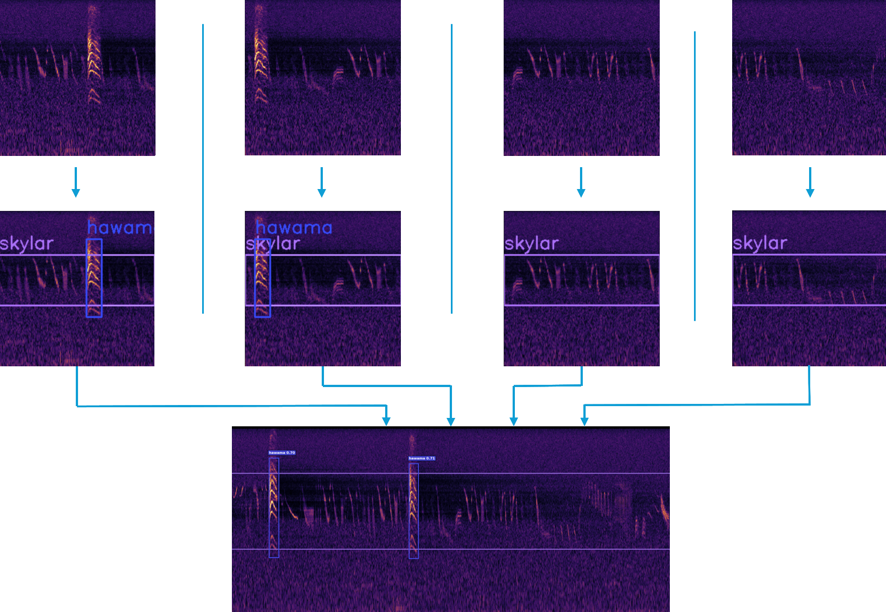

This section describes the algorithmic ideas and the concepts utilized within BirdBox during inference.

For user-facing parameters see [CLI Reference](../cli/workflows.md) or [API Reference](../api/api-type.md).
To compare different models, take a look at [Models and Metrics](../models-and-metrics/overview.md).
If you are interested in the file flow see [File Flows](../data/fileflows.md).

## Inference Algorithm Concept

The key idea of the BirdBox inference is to use YOLO[[1]](#ref-redmon) from Ultralytics[[2]](#ref-jocher) with a sliding window approach.
Both BirdBox models are YOLO11 object detectors: [Just-Bird](../models-and-metrics/just-bird.md) (YOLO11s, one `bird` class) and [Birds-With-Labels](../models-and-metrics/birds-with-labels.md) (YOLO11l, 282 species).
YOLO cannot run on continuous audio, so the recording is cut into short, overlapping images:

1. **Load the audio.** It is mixed to mono and resampled to 32 kHz. Silence is added at the end so that the last 3 s window is complete; boxes in that silence are cut at the real end of the file.
2. **Compute a PCEN mel spectrogram** with STFT[[3]](#ref-allen) and PCEN[[4]](#ref-lostanlen), one minute at a time to bound the memory.
3. **Cut 3 s clips every 1.5 s** (50% overlap) and render each as a 256×256 pixel image.
4. **Run YOLO on the clips** in batches. Boxes below the confidence threshold are dropped (default 0.15 for Just-Bird, 0.2 for Birds-With-Labels), and overlapping boxes within a clip are reduced by non-maximum suppression (`--nms-iou`, default 0.7).
5. **Convert the boxes** from pixels to seconds and Hz. The frequency axis follows the HTK mel scale from 50 Hz to 15 kHz, the inverse of how the training labels were drawn.
6. **Merge the boxes of overlapping windows** into one set of detections per file, with window fusion (Just-Bird) or the song merge (Birds-With-Labels), see below.
7. **Write the detections** in the selected output formats.

To examine the generation of the spectrograms in detail, see [Spectrogram Generation](spectrogram.md).
The various output data formats provided by BirdBox can be examined in [Detection Output Formats](../data/outputs.md).

## Merging the Windows

Consecutive windows overlap by half, so almost every call is seen by two windows. Any vocalization of 1.5 s or less lies completely inside at least one window; only longer vocalizations can be cut into parts. The two views of a call rarely give exactly the same box, and the merge decides what is kept. BirdBox has two merges, and each model has its default (`--merge` overrides it).

### Window Fusion (Just-Bird)

Window fusion keeps one tight box per call:

1. **Ownership.** Each window owns its middle half; the first window also owns the start of the file, the last one the end. A box is kept only from the window that owns its centre, which is the window that sees the call most centrally. The middle halves tile the file, so every call is kept once.
2. **Weighted box fusion.** Boxes of one window that overlap at 2D IoU ≥ 0.4 are averaged, weighted by confidence.
3. **Join split calls.** Boxes in the same frequency band that overlap in time are joined, for example a long call that two windows cut differently.
4. **Drop nested boxes.** A box that lies at least 80% inside a larger box is removed, for example a syllable inside the box of its whole call.

With a phrase gap above 0, step 3 instead joins boxes in the same band that are closer than the gap, so syllables become phrase boxes. Just-Bird uses 0.05 s by default; `--phrase-gap 0` keeps one box per call. See [Window fusion](../cli/detect-birds.md#window-fusion-just-bird-default) for the scores behind these settings.

### Song Merge (Birds-With-Labels)

The song merge joins detections of the same species whose gap is at most the song gap (`--song-gap`, default 0.1 s) into one song box that spans all of them. Most of the Birds-With-Labels training labels box whole songs, and the wide song boxes match them better than single calls. For Just-Bird (`--merge reconstruct`), boxes are only joined if they also share the frequency band, so calls of different birds are not chained.

The following visualization shows the song merge of a species model: each window finds its boxes, and boxes of the same species in neighbouring windows are joined.

For details, see [Song Gap Threshold](../cli/detect-birds.md#-song-gap-song-gap-threshold).

### Filter, Then Merge

The confidence threshold is applied to the raw boxes of each window, before merging. The evaluation tools work the same way: [`detect_birds.py --no-merge`](../cli/detect-birds.md#--no-merge--evaluation-mode) writes the raw boxes once, and [F-beta analysis](../cli/f-beta-score-analysis.md) or [Filter and Merge Detections](../cli/filter-and-merge-detections.md) filter them at any threshold and merge them as detection would.

## References

**[1]** Redmon, J., et al. (2016). "You Only Look Once: Unified, Real-Time Object Detection.“ Proceedings of the IEEE Conference on Computer Vision and Pattern Recognition (CVPR).

**[2]** Jocher, G., & Qiu, J. (2024). *Ultralytics YOLO11* (Version 11.0.0) [Computer software]. AGPL-3.0. [https://github.com/ultralytics/ultralytics](https://github.com/ultralytics/ultralytics){ target="_blank" rel="noopener noreferrer" }. There is no YOLO11 paper; this is the citation given in the [YOLO11 documentation](https://docs.ultralytics.com/models/yolo11/#citations-and-acknowledgements){ target="_blank" rel="noopener noreferrer" }.

**[3]** Allen, J. B., et al. (2005). "A unified approach to short-time Fourier analysis and synthesis." Proceedings of the IEEE, 65(11), 1558–1564.

**[4]** Lostanlen, V. (2021). "Self-calibrating acoustic sensor networks with per-channel energy normalization." Proceedings of Euronoise 2021. Sociedade Portuguesa de Acústica.
