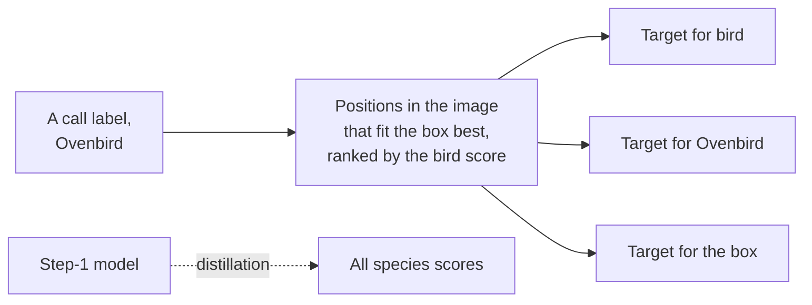

# Bird Class and Names

The [Birds-With-Labels model](birds-with-labels.md) has a class that is no species: `bird`. It finds the calls, and the species classes name them. This page explains why it is there, how it is trained, how a box gets its name and how far the names can be trusted.

---

## Why a Bird Class

A detector with one class per species finds a call only if it recognises the species. Two things work against it:

- **Every species learns from its own boxes alone.** The training split has 559,368 call boxes. The median species has 134 of them, and 160 species have fewer than 50.
- **Unsure means several low scores.** Where several species are possible, each of their classes gives the call a low score. A threshold low enough to find the call then draws one box per species.

Just-Bird has one class, so every box teaches it what a call looks like. The `bird` class brings the same signal into the species model:

A lower threshold does not help the species classes. At 0.05 the previous model reaches as many of Just-Bird's calls in new places (77%) as the bird class does. But then 27% of its boxes lie where Just-Bird has none, against 7% for the bird class.

---

## How It Learns

Step 3 of the [training recipe](birds-with-labels-training.md#step-3-the-bird-class) adds `bird` as the last class (id 633). Three things change in the training loss:

1. **Every box trains two classes,** `bird` and its species. Boxes of unknown species (`????`) train `bird` as well.
2. **The bird score decides which positions learn a box.** YOLO assigns each label to the positions in the image that already predict it best, by class score and overlap (task-aligned assignment [[4]](#ref-tood)). Here the class score is always that of `bird`. So the boxes follow the calls, not the species.
3. **Distillation goes on.** The step-1 model still teaches the species scores. It has no `bird` class, so `bird` learns from the labels alone.

The new class needs a start. With random weights it would need most of the ten epochs to react at all. It starts as the mean of the trained species classes instead, which already responds to what the calls of many species share.

---

## From Score to Name

For each 3 s window the model gives every box a bird score and 633 other scores:

1. **The bird score finds the box.** Boxes above the confidence threshold (0.21) go through non-maximum suppression on that score, across all species. So one call gets one box.
2. **The boxes around it vote on the name.** For each species, the highest score counts among the boxes that overlap it at IoU 0.5 or more.
3. **The top species names the box** if its score is at least 0.25. Otherwise the box is named `bird`. The output keeps the three best species as `alternatives`.

[Species Names](../how-it-works/overview.md#species-names) describes how names survive the merge of overlapping windows.

Asking the neighbours in point 2 is better than reading the box's own species scores. On the song-labelled tests it adds 0.010 to 0.021 to macro F1. On the 14 soundscapes from new places, 39% of the boxes have a species score of at least 0.1, against 26%.

---

## How Reliable Are the Names

Every box of the test sets was compared with the labels. A box lies on a call when at least half of it is inside a label, or at least half of a label is inside it. Only labels with a known species count for right and wrong. The boxes are those before merging:

| Test set | Boxes with a name | Named boxes that are right | `bird` boxes whose first guess is right |
| :--- | ---: | ---: | ---: |
| Five datasets | 45% | 94% | 78% |
| Bird-Sounds-Global | 44% | 92% | 57% |
| Powdermill (new place) | 19% | 74% | 35% |
| Colombia and Costa Rica (new place) | 9% | 68% | 13% |

- **On familiar ground a name can be trusted.** More than nine in ten are right.
- **In a new place a name is a hint.** About seven in ten are right, and the model names far fewer boxes. It says `bird` instead, which is what the class is for.
- **The guess on a `bird` box** is often right on familiar ground, less so elsewhere. The [Demo](../demo.md) shows it as *maybe*.
- **Colombia and Costa Rica is the hardest case.** Only 29 of its 90 species are among the model's classes. Every other bird there can only be named wrongly or `bird`.

The label threshold sets the balance. A lower one names more boxes and gets more of them wrong:

The dashed line is the default, 0.25. It scored best on the validation splits for presence per recording (macro F1 0.591 at 0.15, 0.627 at 0.25, 0.617 at 0.35) and for bout-aware matching. `--label-conf` sets another one.

!!! tip "When names matter most"
    In a place the model was not trained on, raise `--label-conf` to 0.45. On Powdermill 92% of the names are then right, and 7% of the boxes get one.

---

## References

**[4]** Feng, C., Zhong, Y., Gao, Y., Scott, M. R., & Huang, W. (2021). "TOOD: Task-aligned one-stage object detection." Proceedings of the IEEE/CVF International Conference on Computer Vision (ICCV), 3510–3519.
