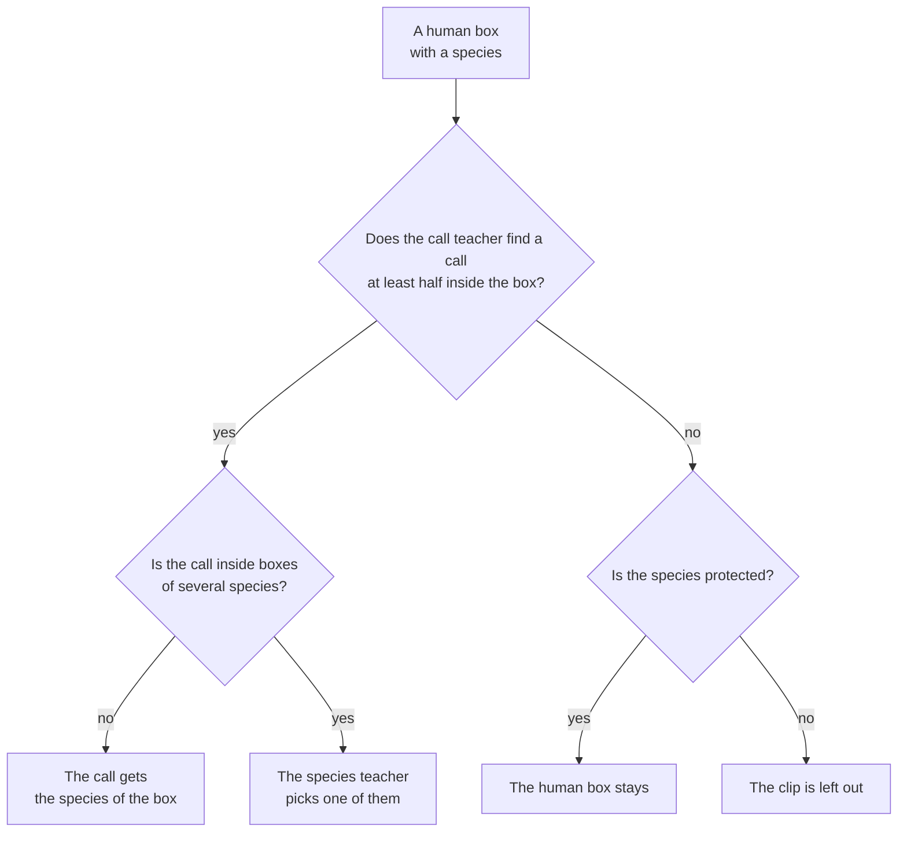

# Birds-With-Labels Call Labels

Four of the six training datasets box a whole song. The [Birds-With-Labels model](birds-with-labels.md) should box each call. This page explains how the song labels were turned into call labels that keep their species, for steps 2 and 3 of the [training recipe](birds-with-labels-training.md#training-recipe).

The rule builds on [Just-Bird's label refinement](just-bird-label-refinement.md). Just-Bird has one class, so it only needs to know where the calls are. With species, three questions are new:

- **Whose call is it?** Labels of different species often overlap. One call can lie in several of them.
- **What if a species loses its labels?** A label whose calls all went to another species would take its clip out of training.
- **What about species the call teacher does not hear?** Some species would vanish from the training data.

---

## Overview

| Dataset | Labels | What happens |
| :--- | :--- | :--- |
| Northeastern US, Western US, Amazon Basin | per song | replaced by call boxes |
| Bird-Sounds-Global | mixed, mostly more than one call | replaced by call boxes |
| Hawai'i, Southern Sierra Nevada | per call | kept as they are |

Two models work together, and neither is asked a question it cannot answer:

- **The call teacher knows where.** It is the teacher of round 2 in Just-Bird's [label refinement](just-bird-training.md#splitting-bouts-into-calls). It has one class and finds calls of any species, down to a confidence of 0.05.
- **The species teacher knows which.** It is the [previous model](birds-with-labels-training.md#models-and-terms), the result of step 1, trained on the human labels. It is asked only where several species are possible.

Neither adds a species of its own. Every call label has a species that a person heard in that clip, at that time and in that frequency band.

Four clips of the training data, with the human labels, the boxes of the call teacher and the call labels made from them. The human boxes appear dotted in the middle:

1. **One song, one species.** The box of the Red-eyed Vireo spans the clip. The call teacher finds its calls, and they all become Red-eyed Vireo. The smaller of two nested boxes is dropped.
2. **Two species at once.** The labels of Wood Thrush and Veery overlap. All three calls lie in the Wood Thrush box, and two of them in the Veery box as well. The species teacher gives those two to the Veery.
3. **A protected species.** The call teacher finds nothing in the Mountain Quail label. The quail is protected, so its label stays.
4. **Nothing found.** The call teacher finds no call in the label. The clip is left out, so that a label over silence teaches nothing.

---

## The Rule

For every clip and every human box in it:

1. **Half inside.** A box of the call teacher qualifies when at least half of it lies inside the human box. It is trimmed to the human box and takes its species.
2. **Call-sized labels.** If no box of the call teacher qualifies for a label of at most 0.5 s, the label takes the box that covers most of it. That box must cover at least half.
3. **One call, several species.** The species teacher decides, see [below](#one-call-several-species).
4. **Duplicates.** Two boxes of one species with an IoU of 0.6 or more are merged. Of two nested boxes of one species, only the larger stays.
5. **Nothing found.** If a human box gets no call, its whole clip is left out, with all its labels. [Protected species](#protected-species) are the exception.

Steps 1, 2, 4 and 5 are Just-Bird's rule, applied to each species on its own. [Just-Bird Label Refinement](just-bird-label-refinement.md#the-rule) gives the reasons for them.

### One Call, Several Species

In a dawn chorus the labels of several species cover the same seconds. A call in the overlap fits all of them. If each of them kept it, one call would train two species, and one of them would learn the wrong sound.

- **The species teacher picks.** Of the species in question, the call goes to the one with the most confident box of the species teacher over the call.
- **Without an opinion, the fit decides.** If the species teacher has no box there, the call goes to the label it lies furthest inside. If two fit equally well, both keep it.
- **No label ends up empty.** A label whose calls all went to other species keeps its calls after all. They then carry two species.

Without the species teacher, 60,630 training calls in Northeastern US and 14,350 in Amazon Basin would have carried two species.

### Protected Species

The call teacher misses some species almost entirely. Most of them have low, tonal calls: doves, tinamous and trogons. The strict rule 5 would leave out their clips, and with them the species.

A species is protected when it would keep less than 25% of its training clips, or fewer than 10 training boxes. Its human box stays where the call teacher found nothing. This applies to 72 species and keeps 14,830 human boxes in the three splits together. A clip with a very rare protected species (fewer than 10 boxes) keeps all its human boxes.

### What Each Part Saves

Each row adds one part of the rule. The bar spans the middle 80% of the species, and the dot marks the median:

- **Just-Bird's rule alone** would remove 16 species from training.
- **The species teacher** makes the labels cleaner. It takes calls away from labels, so more clips are left out.
- **Giving lost labels their calls back** wins these clips back, and more.
- **Protection** keeps every species. Nine in ten species now keep at least 53% of their clips.

---

## What Changed

### Box Length

The median label shrinks to about half, or to less than a third in Northeastern US and to about a third in Amazon Basin. The model follows its labels. The boxes of Birds-With-Labels on the test split shrink in the same way, before any merging:

### Clips

| Clips used | Northeastern US | Western US | Amazon Basin | Bird-Sounds-Global |
| :--- | ---: | ---: | ---: | ---: |
| Train | 108,824 of 116,866 (93%) | 27,212 of 35,082 (78%) | 19,342 of 30,801 (63%) | 70,879 of 84,404 (84%) |
| Val | 22,913 of 24,744 (93%) | 5,358 of 7,105 (75%) | 3,658 of 6,172 (59%) | 14,764 of 17,800 (83%) |

Just-Bird's own labels keep fewer clips from Amazon Basin. The protected species make the difference, since many of them live there.

### Limits

- **A call outside every human box stays unlabelled,** as in the original data. The model learns it as background.
- **A call that the call teacher misses inside a song box loses its label.** This cost the model species until [distillation](birds-with-labels-training.md#step-2-call-boxes-without-forgetting-species) brought them back.
- **The test labels are not touched.** The test results on these pages compare with the labels people drew, songs included.
