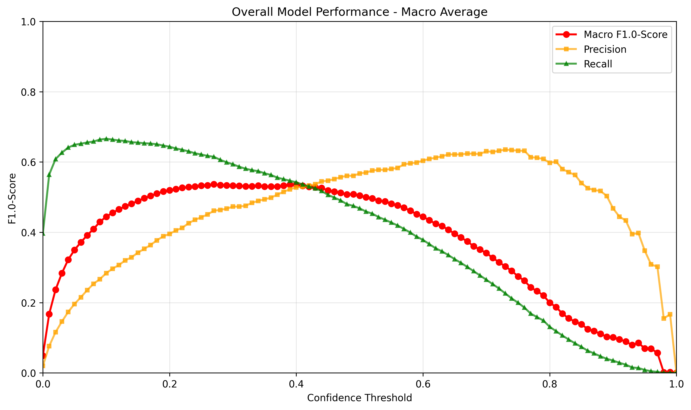
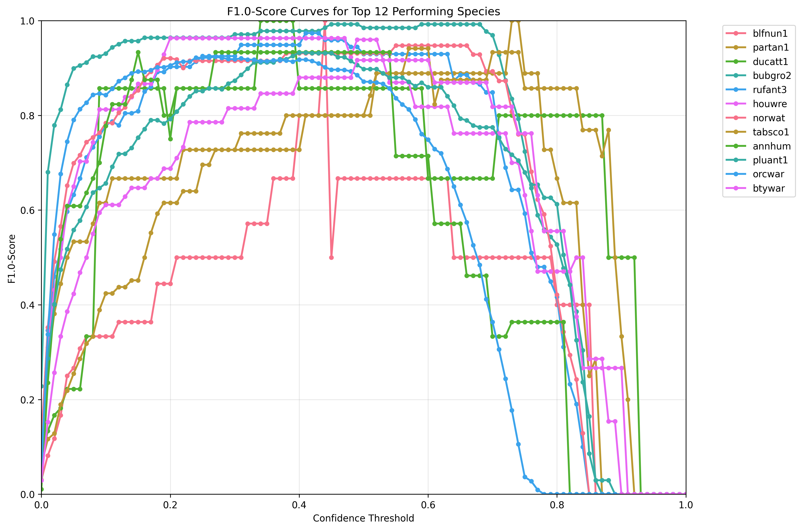

# Birds With Labels Model

The Birds-With-Labels model combines all five zenodo datasets mentioned in the [introduction](overview.md#available-models).
It therefore utilized almost 407 hours of soundscape recordings with 155,584 bounding box labels spanning across 282 different bird species.

!!! info "Formerly All-In-One"
    Until 28 October 2026 this model was called All-In-One. Files made before then still carry the old name: rename `All-In-One.pt` to `Birds-With-Labels.pt` and pass `--species-mapping Birds-With-Labels`. BirdBox no longer accepts the old name.

More on Birds-With-Labels:

- [Training](birds-with-labels-training.md): training curves and boxes per species and split.
- [Model Types](birds-with-labels-model-types.md): the export formats and how closely they match the PyTorch model.

---

## Precision, Recall and F1-Score

The graphs below show the performance of the model on the **testset** under different confidence thresholds.
The measured metrics are precision, recall and the F1-score.
If we want to optimize the F1-score for the model, one should thus pick a confidence-threshold-value around 0.27.

!!! info "Rising Recall at Low Confidence"
    The rising recall from confidence values 0 to ~0.1 is unusual but by design. At very low confidence thresholds, the merging algorithm produces imprecise merged boxes that can accidentally overlap more ground truth labels. See [How it works](../how-it-works/overview.md) for details.

---

## Top Performing Species

The data below shows the F1-score for the best 12 performing species within the test dataset.
This implies that a detection of those species in new unseen data is highly accurate if the confidence threshold is set to around 0.4.

