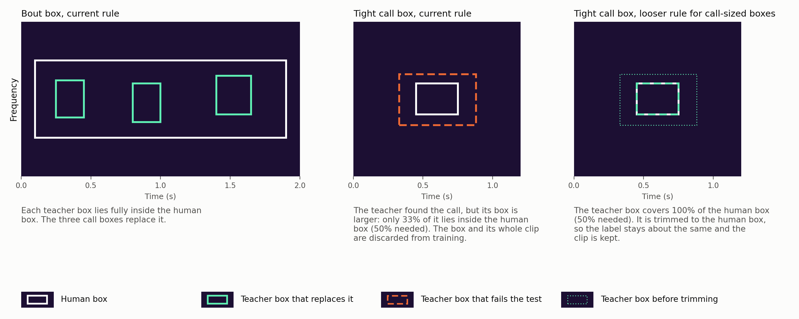
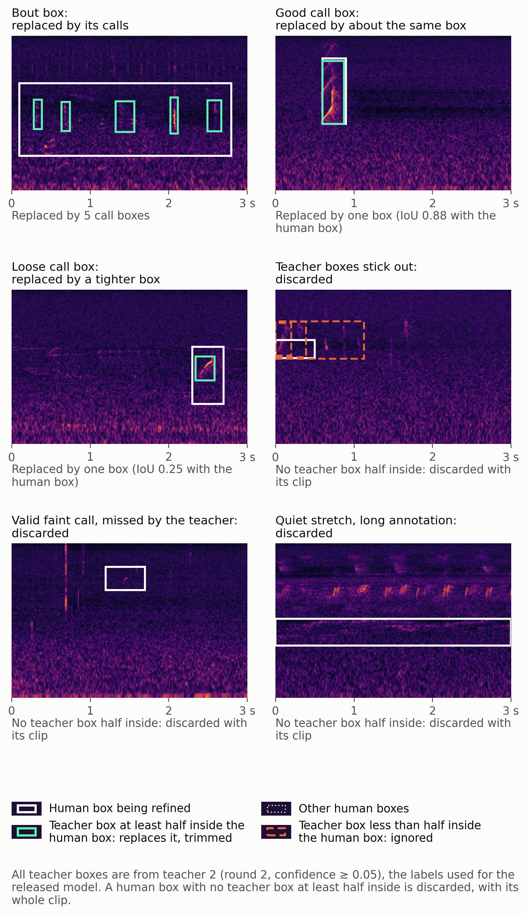
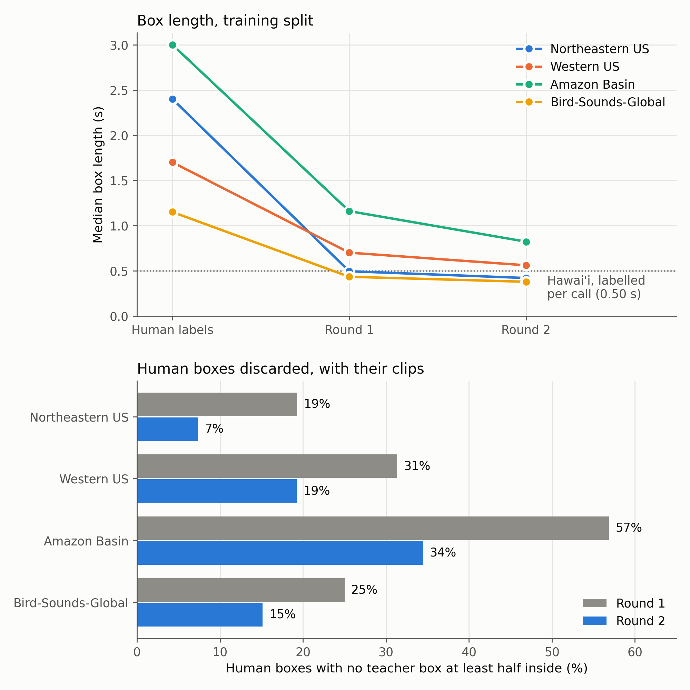
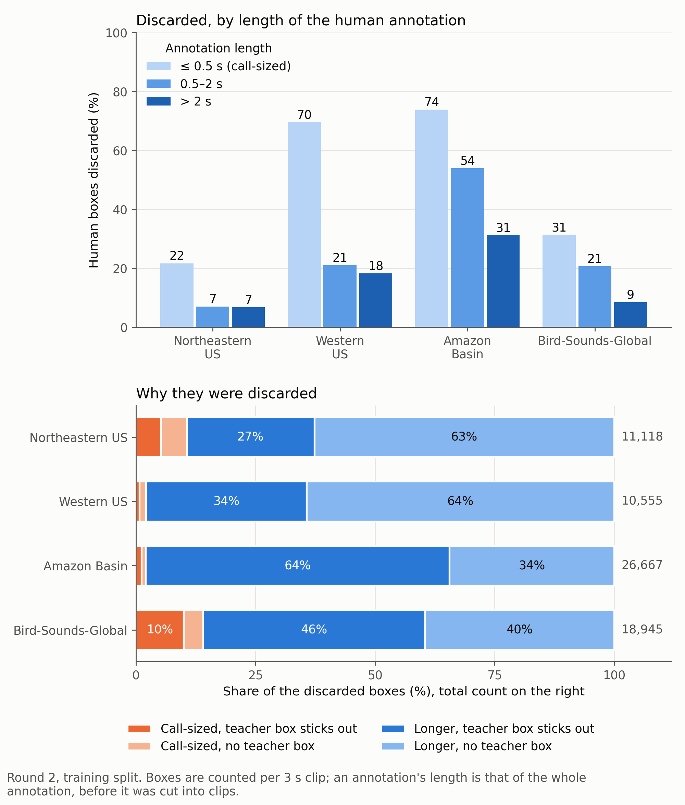

# Just-Bird Label Refinement

Most training datasets of the [Just Bird model](just-bird.md) put one box around a whole song or bout, while the model should draw one box per call. Before training, those boxes are replaced by call boxes from a teacher model, in two rounds (see [Training Recipe](just-bird-training.md#training-recipe)). This page explains the rule, what each round changes, which boxes and clips are discarded, and a looser rule that was tested.

---

## Overview

The refinement changes only the four bout-labelled datasets: Northeastern US, Western US, Amazon Basin and Bird-Sounds-Global. Hawai'i and Southern Sierra Nevada keep their human call labels ([Which Datasets Are Refined](#which-datasets-are-refined) explains why). It works on the training images, 3 s clips that overlap by half. An annotation longer than a clip is cut into one box per clip, and each of these boxes is handled on its own.

Terms used on this page:

- **Human box:** a box an annotator drew. In these four datasets it usually covers a whole song or bout of several seconds.
- **Replaced:** the teacher found at least one call box for the human box, and those call boxes take its place. A human box can be replaced by many call boxes or by one.
- **Discarded:** the teacher found no call box that qualifies (see the rule below), so the human box cannot be replaced. It is not used as the annotator drew it either: **the human box and its whole 3 s clip are discarded from training**, including any other boxes in that clip. Training on long bout boxes made the model worse on a new site (F1 0.122 against 0.380, see [Each Step on the Unseen Site](just-bird-training.md#each-step-on-the-unseen-site)), so none is kept.
- **Call-sized:** the whole annotation, before it was cut into clips, is at most 0.5 s long, the median length of the Hawai'i call labels. Here the annotator boxed a single call. Longer annotations cover a phrase, song or bout; they are 96% of the boxes in these four datasets.

---

## Which Datasets Are Refined

The datasets differ in what one human box covers. In each, every box was traced back to the whole annotation it was cut from (training split, boxes counted per 3 s clip):

| Dataset | What one box covers | Median annotation length | Boxes from call-sized annotations | Refined |
| :--- | :--- | :---: | :---: | :---: |
| Hawai'i | a call | 0.60 s | 47% | no |
| Southern Sierra Nevada | a call | 0.40 s | 55% | no |
| Bird-Sounds-Global | mixed: calls, songs, bouts | 2.08 s | 7% | yes |
| Western US | a bout | 3.30 s | 1% | yes |
| Northeastern US | a bout | 5.50 s | 4% | yes |
| Amazon Basin | a bout | 12.80 s | 1% | yes |

The annotation guidelines of Northeastern US, Western US and Amazon Basin let annotators join consecutive calls with pauses under 5 s into one box. The guidelines of Southern Sierra Nevada have no such clause, and Hawai'i is labelled per call as well. Bird-Sounds-Global, soundscapes from xeno-canto, mixes both styles; most of its boxes cover more than one call.

Hawai'i and Southern Sierra Nevada are left as they are, for four reasons:

- **There is nothing to split.** About half of their boxes are call-sized, and the median annotation is at most 0.6 s. The rule exists to cut long bout boxes into calls.
- **The rule would lose good labels.** A call box the teacher finds is replaced by about the same box, so nothing is gained. A call box the teacher misses is discarded with its whole clip, like the [valid faint call](#the-rule) below. On call-level labels the rule can only cost data.
- **Hawai'i defines what a call box is.** Teacher 1 learned from the Hawai'i labels. Relabelling them with a model trained on them would only feed the teacher's own mistakes back into the training data.
- **Southern Sierra Nevada was the unseen test site** while the recipe was developed (see [Training Recipe](just-bird-training.md#training-recipe)). Its labels had to stay human to measure the teachers and models against. The released model adds them unchanged.

---

## The Rule

For every clip:

1. The teacher proposes boxes with a confidence of at least 0.05. The cutoff is low on purpose: inside a box a human drew, even a weak detection is likely a call.
2. **Half-inside test:** a teacher box qualifies for a human box when at least half of the teacher box lies within the human box. Small call boxes inside a bout box pass easily.
3. The qualifying teacher boxes replace the human box. They are trimmed to its edges, so a new box never leaves the time and frequency range the annotator marked.
4. Near-duplicates (IoU ≥ 0.6, for example one call inside two overlapping human boxes) are merged, keeping the more confident box.
5. If no teacher box qualifies, the human box is discarded, and with it the whole clip.

The test is measured on the teacher box, which makes it strict with tight call boxes. The teacher often draws a slightly larger box around the same call. Then less than half of the teacher box lies inside the tight human box (middle), so a good label is discarded with its clip. The looser rule on the right is tested in [Testing a Looser Rule](#testing-a-looser-rule-for-call-sized-boxes).

Real clips from the training data. All teacher boxes in the figure are from **teacher 2**, the second round, whose labels the released model was trained on:

In the top row the human box is replaced: a bout box by five call boxes, a call box that already fits its call by an almost identical box, and a loose call box by a tighter one. In the bottom row it is discarded with its clip, for the reasons in [Why Boxes Are Discarded](#why-boxes-are-discarded).

The bottom row, round by round:

- **Teacher boxes stick out** (Western US): discarded in round 1 and in round 2.
- **Valid faint call** (Bird-Sounds-Global): the human box is correct, but discarded in round 1 and in round 2. Neither teacher finds the call, even with the confidence cutoff lowered from 0.05 to 0.001: no box of teacher 1 or teacher 2 lies even a third inside the human box. So the clip is lost to training, with this good label and with the call box that replaced the bout box next to it. This is the price of the rule: a call that no teacher detects cannot be told apart from a stretch of silence inside a long annotation, and both are discarded.
- **Quiet stretch** (Amazon Basin): replaced in round 1, where teacher 1 drew boxes in it, and discarded in round 2. It is one of the few clips that round 2 discards and round 1 kept (see the next section).

Two things the rule cannot do:

- **It never adds a label.** A call outside every human box stays unlabelled, as in the original data.
- **A call the teacher misses inside a bout box loses its label**, because the call boxes replace the whole bout box. In the bout clip above, the short, low sound at about 0.45 s gets no box in either round and now counts as background. A lower confidence cutoff would find more of these calls, but would also accept more noise.

---

## What Each Round Changes

Round 1 cuts the median box length from 1.15–3.0 s to 0.43–1.16 s, and round 2 to 0.38–0.82 s, close to the 0.50 s of the call-level Hawai'i labels. The larger effect of round 2 is that it replaces more of the bout boxes, so far fewer clips are discarded:

| Dataset | Training clips | Discarded, round 1 | Discarded, round 2 | Used for training |
| :--- | :---: | :---: | :---: | :---: |
| Northeastern US | 116,780 | 25,847 (22%) | 10,617 (9%) | 106,163 |
| Western US | 36,435 | 13,605 (37%) | 9,014 (25%) | 27,421 |
| Amazon Basin | 31,264 | 23,730 (76%) | 18,101 (58%) | 13,163 |
| Bird-Sounds-Global | 84,404 | 23,826 (28%) | 15,334 (18%) | 69,070 |

Round 2 does not build on the labels of round 1. Both rounds start again from the original human boxes, so teacher 2 gets a new chance at every clip that round 1 discarded. Teacher 2 never trained on those clips (it was trained on the round-1 labels, without the discarded clips), but it learned from far more data than teacher 1, which saw only Hawai'i. Comparing the discarded clips of the two rounds:

| Dataset | Discarded, round 1 | Kept again in round 2 | Discarded in both rounds | Kept in round 1, discarded in round 2 |
| :--- | :---: | :---: | :---: | :---: |
| Northeastern US | 25,847 | 15,433 | 10,414 | 203 |
| Western US | 13,605 | 4,668 | 8,937 | 77 |
| Amazon Basin | 23,730 | 5,795 | 17,935 | 166 |
| Bird-Sounds-Global | 23,826 | 8,938 | 14,888 | 446 |
| All four | 87,008 | 34,834 (40%) | 52,174 | 892 |

Teacher 2 finds the calls in 40% of the clips that round 1 discarded. Only 892 clips go the other way. A call that neither teacher finds, like the faint call above, stays discarded.

### Why There Is No Third Round

A third round would train teacher 3 on the round-2 labels and relabel again. It was not run, because round 2 already brought no gain on full recordings of the unseen site:

| Labels of the bout-labelled datasets | F1 at IoU 0.5, unseen site, at the Hawai'i-val threshold | Discarded clips |
| :--- | :---: | :---: |
| Human boxes | 0.122 | none |
| Round 1 | 0.380 | 87,008 |
| Round 2 | 0.384 | 53,066 |

- **Round 1 brought the big step**, from bout boxes to call boxes.
- **Round 2 ties round 1** on full recordings. Its gains lie elsewhere: 33,942 more clips are kept (19% more bout-labelled training data), 3 s clips score higher, and the threshold chosen on Hawai'i val carries over to the new site.
- **A third round could only win back clips from the 52,174 discarded in both rounds**, many of them silent stretches of long annotations. Winning back 1,604 of them with the [looser rule](#testing-a-looser-rule-for-call-sized-boxes) moved no score beyond what another training seed would.

A third round was not tested, so this is a judgment from the trend, not a measurement. Each round needs a new teacher, a relabelling of all four datasets and a final training to measure it.

Amazon Basin loses the most. Its recordings are dense choruses with long, overlapping annotations, and even after round 2 more than half of its clips are discarded.

---

## Why Boxes Are Discarded

A discarded box is not one the teacher judged to be correct: when the teacher finds the call in a good call box, it replaces it with about the same box (the second real clip above). A human box is discarded only when no teacher box passes the half-inside test, for one of two reasons:

- **No teacher box.** The teacher finds nothing in the box. Usually this is a stretch of a long annotation where the bird is silent or barely audible in this clip, or a faint call.
- **The teacher box sticks out.** Teacher boxes touch the human box, but less than half of each lies inside it. This happens where boxes of several birds overlap, as in the Amazon Basin choruses, and where the teacher draws a larger box around a call than the annotator did (the drawing above).

To see which boxes these are, every human box was traced back to the whole annotation it was cut from, and the teacher was run again on every clip with a discarded box:

| Dataset | Human boxes | Call-sized | Discarded, all boxes | Discarded, call-sized | Call-sized share of the discarded boxes |
| :--- | :---: | :---: | :---: | :---: | :---: |
| Northeastern US | 151,983 | 5,423 (3.6%) | 7% | 22% | 11% |
| Western US | 54,951 | 316 (0.6%) | 19% | 70% | 2% |
| Amazon Basin | 77,792 | 733 (0.9%) | 34% | 74% | 2% |
| Bird-Sounds-Global | 125,370 | 8,467 (6.8%) | 15% | 31% | 14% |
| All four | 410,096 | 14,939 (3.6%) | 16% | 31% | 7% |

Round 2, training split, boxes counted per 3 s clip.

- **Call-sized boxes are discarded more often** than longer ones: 31% against 16% over all four datasets. In 62% of these cases the teacher did find something, but its box sticks out, as in the drawing.
- **But call-sized boxes are rare.** These datasets were annotated per bout, and only 3.6% of their boxes are call-sized. They make up 7% of the discarded boxes.
- **Most discarded boxes come from long annotations.** In 48% of them the teacher found nothing, mostly silent or faint stretches. In the rest its boxes stick out, above all in Amazon Basin (65% of its discarded boxes).

---

## Testing a Looser Rule for Call-Sized Boxes

Because the half-inside test rejects good call boxes whenever the teacher draws a larger box, a looser rule was tested on the same hold-out. For call-sized human boxes only, a teacher box also qualifies when it covers at least half of the human box. It is trimmed to the human box, so the label stays about the same as the annotator drew it, and the clip stays in training. In short: if the teacher confirms there is a call, the clip is kept.

This keeps 1,604 clips that the current rule discards, 0.6% more bout-labelled training data. A model trained with them, with the recipe otherwise unchanged, scores:

| Rule | Unseen site, IoU 0.25 / 0.5 / 0.75 | Unseen site, IoU 0.5 at the Hawai'i-val threshold | Hawai'i val, IoU 0.5 |
| :--- | :---: | :---: | :---: |
| Current | 0.540 / 0.385 / 0.116 | 0.384 | 0.581 |
| Looser for call-sized boxes | 0.541 / 0.389 / 0.120 | 0.387 | 0.583 |

Every score is 0.001–0.005 higher, less than a second training run with another seed would move it. Discarding these clips costs nothing measurable, and keeping them does no harm. The released model keeps the current rule. The looser one remains an option (`--call-cover` in `refine_coarse_boxes.py`) for the next time the labels are rebuilt.
