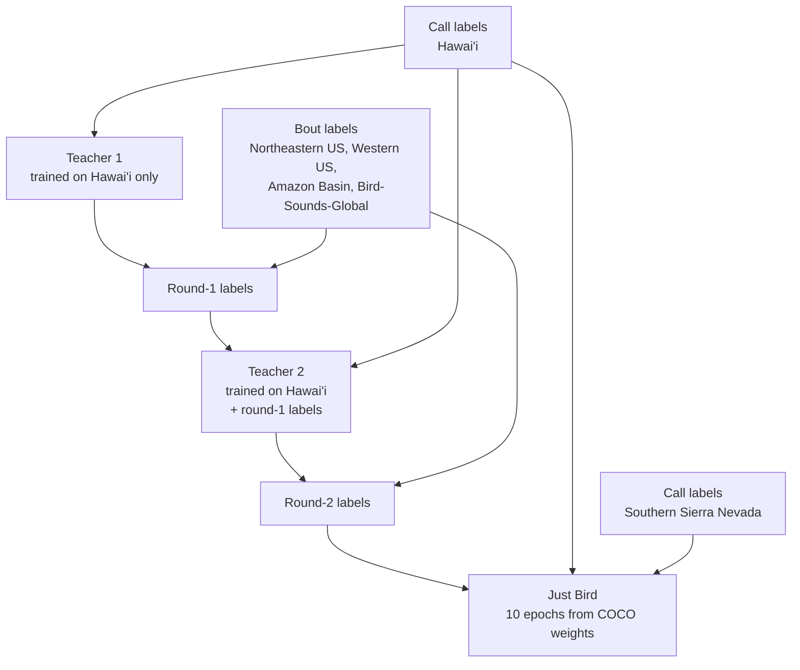

# Just-Bird Training

How the [Just Bird model](just-bird.md) was trained: the recipe and why each step is there, the training curves of the released model, and the boxes per split. [Just-Bird Label Refinement](just-bird-label-refinement.md) explains how the training labels were made.

---

## Training Recipe

The recipe was worked out on the same hold-out: every model in this section was trained without Southern Sierra Nevada and tested on its full recordings, as in [Performance on an Unseen Site](just-bird.md#performance-on-an-unseen-site). The released model repeats the last step with Southern Sierra Nevada added.

### Splitting Bouts into Calls

Trained on the human labels of all datasets, the model learns the bout style and draws boxes of several seconds on a new site. It then scores lower there than a model trained on Hawai'i alone (see the first two bars [below](#each-step-on-the-unseen-site)). The bout labels are therefore replaced by call labels before the final training. A teacher model looks for calls inside each human box, and the call boxes it finds replace the box:

- **Round 1** uses a teacher trained on Hawai'i only, which never saw a bout box.
- **Round 2** uses a teacher trained on all sets with the round-1 labels, and replaces the original human boxes again.
- **There is no round 3.** Round 2 already tied round 1 on the unseen site ([Why There Is No Third Round](just-bird-label-refinement.md#why-there-is-no-third-round)).

This is self-training: a teacher model labels the data and a student model is trained on these labels, also called pseudo-labels [[11]](#ref-lee). The terms teacher and student come from knowledge distillation [[7]](#ref-hinton). Making the student of one round the teacher of the next follows Noisy Student training, where each new student learns from the labels of the previous one and ends up better than its teacher [[29]](#ref-xie). Students with the same architecture as their teacher can likewise outperform it [[4]](#ref-furlanello). Unlike these methods, the teacher here does not label free data: it only places call boxes inside the boxes a human drew.

[Just-Bird Label Refinement](just-bird-label-refinement.md) explains the rule, what each round changes, and which boxes and clips are discarded.

### Each Step on the Unseen Site

- **More data needs better labels.** The bout-labelled datasets with their human labels lower F1 from 0.280 to 0.122. With the teacher's call labels the same data raises it to 0.380–0.384.
- **Round 2** ties round 1 on full recordings. It is kept because it discards less data, scores higher on 3 s clips (F1 0.368 against 0.343 at IoU 0.5, both trained on a quarter of the data), and its threshold transfers: the one chosen on Hawai'i val loses almost nothing on the new site (0.384 against the best 0.385; round 1: 0.380 against 0.393).
- **The previous recipe** trained on the human labels for up to 100 epochs, with early stopping and augmentation from a hyperparameter search.

### Ten Epochs

Training longer does not help a new site. In a 30-epoch run, F1 on the unseen site is 0.361 after the first epoch and about 0.38 from epoch 6 on, then slowly declines, while Hawai'i val holds at 0.585–0.588. The checkpoints before epoch 30 are taken before that run's learning rate has decayed. The 10-epoch run decays fully within its 10 epochs and scores best on the unseen site (0.385). Early stopping on Hawai'i val cannot see this, so the recipe uses a fixed 10 epochs. Choosing a model on validation data from the training sites is a known weak point when the test data comes from elsewhere [[5]](#ref-gulrajani).

### Training Curves of the Rounds

Teacher 1 was trained for up to 100 epochs with early stopping and kept epoch 24. Teacher 2 and the final recipe run a fixed schedule that decays fully and keep the last epoch. On Hawai'i val the three end within about 0.03 mAP50 of each other (0.63–0.66). Only the unseen site separates them.

---

## Training Results

The figure shows the validation mAP and the box loss after each epoch. The validation set is the Hawai'i and Southern Sierra Nevada val splits, the two datasets with call-level labels. The drop in training loss at epoch 8 is where mixup augmentation is switched off.

!!! info "Model Checkpoint"
    The checkpoint with the best validation fitness was kept. That was the last epoch (10).

---

## Data Splits

Each dataset was split once into train, val and test, about 70/15/15 (see [Dataset Splits](overview.md#dataset-splits)). Just-Bird does not use these splits as they are. It has no test split and only a small validation set:

- **No test split.** A test split from the same recordings only measures in-domain performance. Just-Bird was measured on a site it never saw instead (see [Performance on an Unseen Site](just-bird.md#performance-on-an-unseen-site)), so the test splits of all datasets are used for training.
- **Validation on call labels only.** Only the val splits of Hawai'i and Southern Sierra Nevada, the two datasets labelled per call, are used for validation. Bout-labelled val splits would reward loose boxes. Validation follows the training and picks the checkpoint, which was the last epoch (see [Training Results](#training-results)). With over a million training boxes, 1.4% for validation is still 16,755 boxes in 9,702 images.
- **Three val splits are left out.** The val splits of Northeastern US, Western US and Amazon Basin are used neither for training nor for validation. The Western US one served as unseen data to check the [phrase gap](../cli/detect-birds.md#window-fusion-just-bird-default) and the confidence threshold of the released model.
- **Bird-Sounds-Global** is used in full for training, all three of its splits.

Boxes per dataset, counted per 3 s training image. Consecutive images overlap by 50%, so most calls are counted twice. For the four refined datasets these are the call boxes after [label refinement](just-bird-label-refinement.md), without the discarded clips.

| Dataset | Labels | Splits used for training | Train | Val | Not used |
| :--- | :--- | :--- | ---: | ---: | ---: |
| Hawai'i | human, per call | train, test | 75,635 | 13,237 | – |
| Southern Sierra Nevada | human, per call | train, test | 19,716 | 3,518 | – |
| Northeastern US | refined | train, test | 486,580 | – | 96,704 |
| Western US | refined | train, test | 115,133 | – | 20,576 |
| Amazon Basin | refined | train, test | 69,234 | – | 12,196 |
| Bird-Sounds-Global | refined | train, val, test | 395,940 | – | – |
| **All** | | | **1,162,238** | **16,755** | **129,476** |
| **Share of train + val** | | | **98.6%** | **1.4%** | |

---

## References

**[4]** Furlanello, T., Lipton, Z. C., Tschannen, M., Itti, L., & Anandkumar, A. (2018). "Born again neural networks." Proceedings of the 35th International Conference on Machine Learning (ICML), PMLR 80:1607–1616.

**[5]** Gulrajani, I., & Lopez-Paz, D. (2021). "In search of lost domain generalization." International Conference on Learning Representations (ICLR).

**[7]** Hinton, G., Vinyals, O., & Dean, J. (2015). "Distilling the knowledge in a neural network." arXiv preprint arXiv:1503.02531.

**[11]** Lee, D.-H. (2013). "Pseudo-Label: The simple and efficient semi-supervised learning method for deep neural networks." ICML 2013 Workshop on Challenges in Representation Learning.

**[29]** Xie, Q., Luong, M.-T., Hovy, E., & Le, Q. V. (2020). "Self-training with Noisy Student improves ImageNet classification." Proceedings of the IEEE/CVF Conference on Computer Vision and Pattern Recognition (CVPR). https://doi.org/10.1109/CVPR42600.2020.01070
