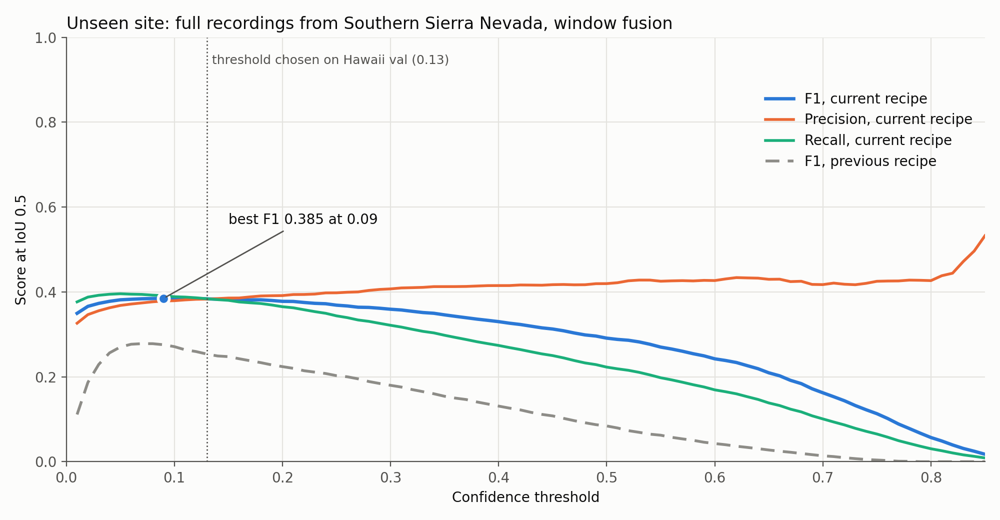
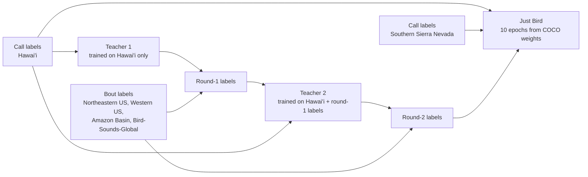
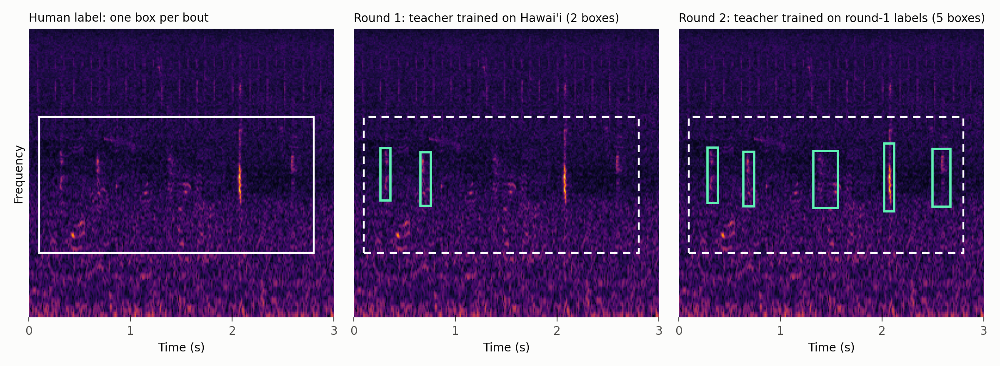
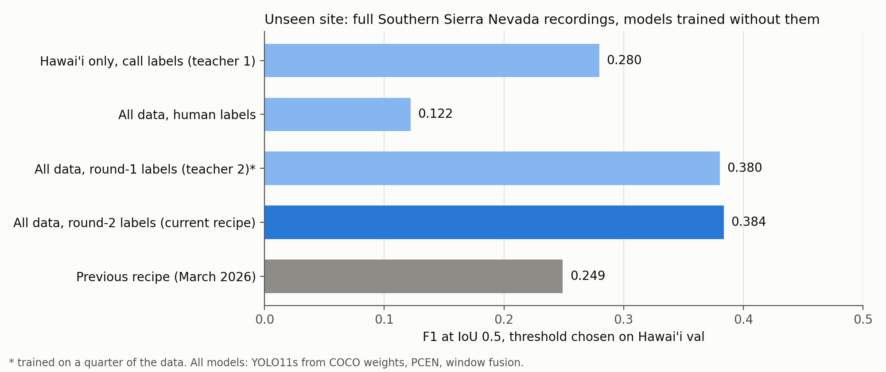
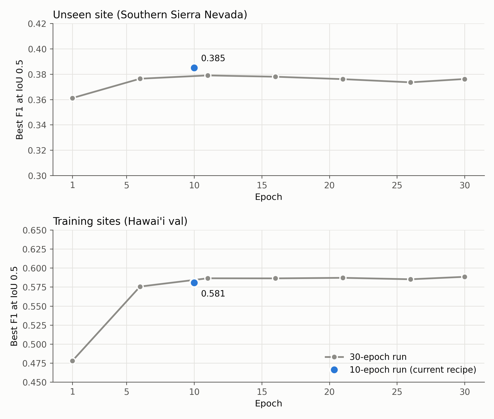
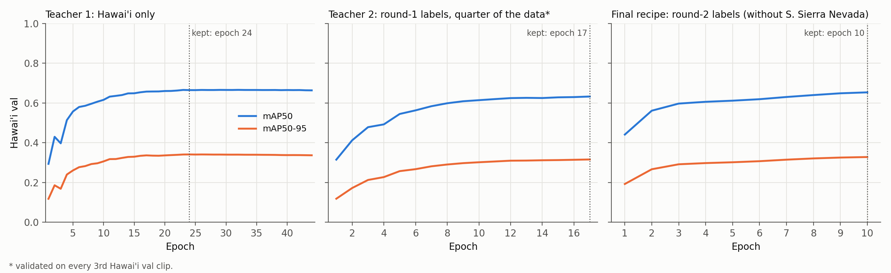
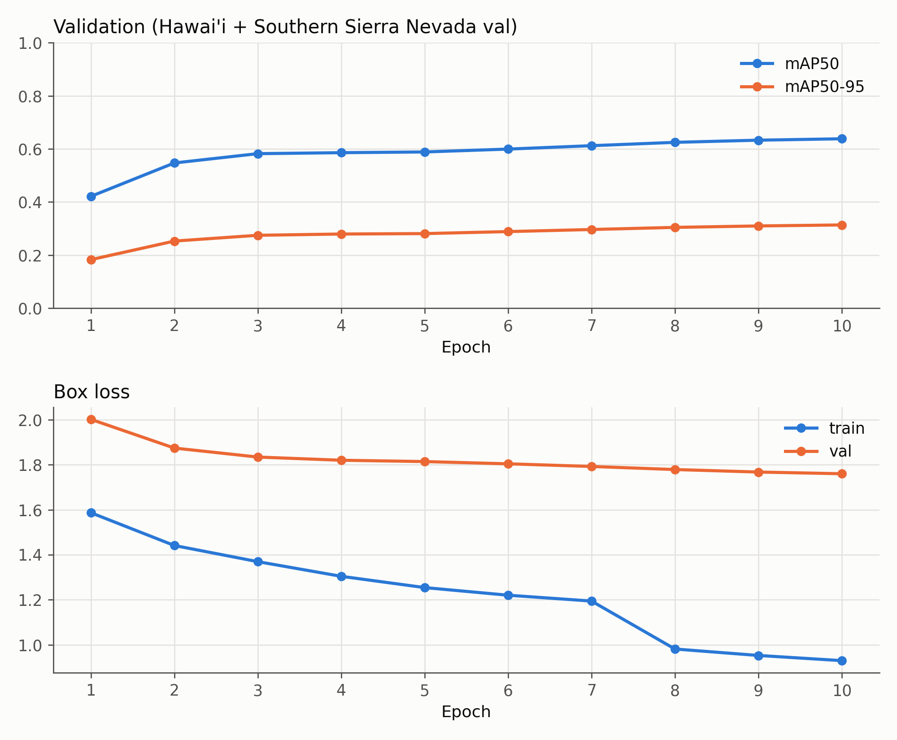

# Just Bird Model

The Just Bird model has a single class, `bird`. It finds bird vocalizations of any species and draws a tight box around each call. Detections are merged with [window fusion](../cli/detect-birds.md#window-fusion-just-bird-default) by default, which also joins same-band boxes less than 0.05 s apart into one phrase box (`--phrase-gap`, `0` keeps one box per call).

The current model was released on 20 October 2026 and replaces the March 2026 model.

---

## Training Data

The model was trained on all five regional datasets and on Bird-Sounds-Global:

- [Southwestern Amazon Basin](https://doi.org/10.5281/zenodo.7079124){ target="_blank" rel="noopener noreferrer" }
- [Island of Hawai'i](https://doi.org/10.5281/zenodo.7078499){ target="_blank" rel="noopener noreferrer" }
- [Northeastern United States](https://doi.org/10.5281/zenodo.7079380){ target="_blank" rel="noopener noreferrer" }
- [Southern Sierra Nevada mountain range](https://doi.org/10.5281/zenodo.7525805){ target="_blank" rel="noopener noreferrer" }
- [Western United States](https://doi.org/10.5281/zenodo.7050014){ target="_blank" rel="noopener noreferrer" }
- Bird-Sounds-Global: annotated soundscapes from [xeno-canto](https://xeno-canto.org){ target="_blank" rel="noopener noreferrer" } (Lifeplan and SystemShift projects) from many countries

**Labels.** Hawai'i and Southern Sierra Nevada are annotated per call. The other datasets mostly put one box around a whole song or bout. Their boxes were replaced by single-call boxes in two rounds of self-training: a model trained on call-level labels found the calls inside each human box. A clip with a human box it could not replace was discarded, together with all its other boxes. [Training Recipe](#training-recipe) shows why, and [Just-Bird Label Refinement](just-bird-label-refinement.md) how.

**Recipe.** YOLO11s, started from the COCO weights, trained for 10 epochs on PCEN spectrograms. The learning rate decays to its final value within those 10 epochs, and mixup augmentation is switched off for the last 3 (mosaic augmentation is not used). There is no early stopping.

---

## Performance on an Unseen Site

Because the model was trained on every dataset, none of them is left to test it on recordings from a site it has not seen. The transfer was therefore measured with the same recipe trained without Southern Sierra Nevada and then run on the full Southern Sierra Nevada recordings, a zero-shot test in the sense of [[2]](#ref-bansal). The previous model's recipe was retrained and tested in the same way.

Event F1 on full recordings with window fusion (including the removal of nested boxes, phrase gap off):

| Recipe | IoU 0.25 | IoU 0.5 | IoU 0.75 | IoU 0.5 at the threshold chosen on Hawai'i val |
| :--- | :---: | :---: | :---: | :---: |
| Current | **0.540** | **0.385** | **0.116** | **0.384** |
| Previous (March 2026) | 0.463 | 0.278 | 0.059 | 0.249 |

The graph shows precision, recall and F1 at IoU 0.5 for every confidence threshold. The curves come from the model trained without Southern Sierra Nevada, not from the released weights, which were trained on it. The dashed line is the previous recipe retrained the same way, not the March 2026 model.

- **Confidence threshold:** **0.15**, the default in `detect_birds.py` and the [Demo](../demo.md). The best threshold on the Hawai'i validation recordings is 0.13 to 0.15, and it carries over to the unseen site with almost no loss (0.384 against the best 0.385).
- **Phrase gap:** some Southern Sierra Nevada labels box a whole phrase where the model boxes single syllables, which lowers the scores at IoU 0.5 and above. The default phrase gap of 0.05 s raises F1 at IoU 0.5 there from 0.385 to 0.396, and on song-labelled Western-US validation minutes from 0.170 to 0.197. On call-level labels it costs about 0.05 (Hawai'i val: 0.581 to 0.531). If your annotations box single calls, pass `--phrase-gap 0`. [Phrase boxes](../cli/detect-birds.md#window-fusion-just-bird-default) has the numbers for other gaps.
- **In-domain:** on the full Hawai'i validation recordings, the released model reaches F1 0.590 at IoU 0.5 (threshold 0.14, phrase gap off).

---

## Training Recipe

The recipe was worked out on the same hold-out: every model in this section was trained without Southern Sierra Nevada and tested on its full recordings, as in [Performance on an Unseen Site](#performance-on-an-unseen-site). The released model repeats the last step with Southern Sierra Nevada added.

### Splitting Bouts into Calls

Trained on the human labels of all datasets, the model learns the bout style and draws boxes of several seconds on a new site. It then scores lower there than a model trained on Hawai'i alone (see the first two bars [below](#each-step-on-the-unseen-site)). The bout labels are therefore replaced by call labels before the final training. A teacher model looks for calls inside each human box, and the call boxes it finds replace the box:

- **Round 1** uses a teacher trained on Hawai'i only, which never saw a bout box.
- **Round 2** uses a teacher trained on all sets with the round-1 labels, and replaces the original human boxes again.

[Just-Bird Label Refinement](just-bird-label-refinement.md) explains the rule, what each round changes, and which boxes and clips are discarded.

### Each Step on the Unseen Site

- **More data needs better labels.** The bout-labelled datasets with their human labels lower F1 from 0.280 to 0.122. With the teacher's call labels the same data raises it to 0.380–0.384.
- **Round 2** ties round 1 on full recordings. It is kept because it discards less data, scores higher on 3 s clips (F1 0.368 against 0.343 at IoU 0.5, both trained on a quarter of the data), and its threshold transfers: the one chosen on Hawai'i val loses almost nothing on the new site (0.384 against the best 0.385; round 1: 0.380 against 0.393).
- **The previous recipe** trained on the human labels for up to 100 epochs, with early stopping and augmentation from a hyperparameter search.

### Ten Epochs

Training longer does not help a new site. In a 30-epoch run, F1 on the unseen site is 0.361 after the first epoch and about 0.38 from epoch 6 on, then slowly declines, while Hawai'i val holds at 0.585–0.588. The checkpoints before epoch 30 are taken before that run's learning rate has decayed. The 10-epoch run decays fully within its 10 epochs and scores best on the unseen site (0.385). Early stopping on Hawai'i val cannot see this, so the recipe uses a fixed 10 epochs.

### Training Curves of the Rounds

Teacher 1 was trained for up to 100 epochs with early stopping and kept epoch 24. Teacher 2 and the final recipe run a fixed schedule that decays fully and keep the last epoch. On Hawai'i val the three end within about 0.03 mAP50 of each other (0.63–0.66). Only the unseen site separates them.

---

## Training Results

The figure shows the validation mAP and the box loss after each epoch. The validation set is the Hawai'i and Southern Sierra Nevada val splits, the two datasets with call-level labels. The drop in training loss at epoch 8 is where mixup augmentation is switched off.

!!! info "Model Checkpoint"
    The checkpoint with the best validation fitness was kept. That was the last epoch (10).

---

## Species Distribution Across Splits

The following table shows the number of boxes in the training and validation images, counted per 3 s training image. Consecutive images overlap by 50%, so most calls are counted twice. The training split includes the test splits of all datasets, because the transfer was measured on a held-out site instead (see above).

| Species | Train | Val | Test | Total | 70/15/15 Quality {: data-sort-method="mixed-split" } |
| :--- | :---: | :---: | :---: | :---: | :--- |
| bird | 1,162,238 | 16,755 | 0 | 1,178,993 | 98.6/1.4/0.0 |

---

## References

[2] Bansal, A., Sikka, K., et al. (2018). "Zero-shot object detection." Proceedings of the European Conference on Computer Vision (ECCV), 384–400.
